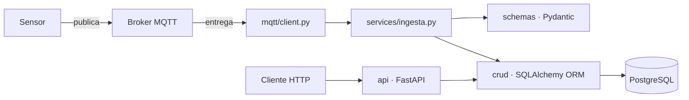

# Taller 2 — API IoT con FastAPI, MQTT y PostgreSQL

## 1. Información General

| Campo | Valor |
|---|---|
| Proyecto | API para adquisición, validación y consulta de datos IoT |
| Integrantes | **[Emanuel Chavarria Arcila]** y **[Andrés Santiago Henao Carvajal]** |
| Asignatura | Aplicaciones y Servicios Web — Tecnología en Desarrollo de Software |
| Fecha | 10 de octubre de 2026 |
| Sensor asignado | `WQ-001` (campo `codigo` de la tabla `sensores`, id `9`) |
| Tópico MQTT | `iot/sensors/WQ-001/data` |
| Broker | `emqx.coriotlab.co` |

La guía original del taller está en [`docs/guia-taller-2.md`](docs/guia-taller-2.md).

## 2. Descripción del Sistema

### Problema resuelto

Un sensor IoT publica mediciones por MQTT. La aplicación se suscribe al tópico del sensor asignado, valida cada mensaje, almacena **solo los mensajes completamente válidos** en PostgreSQL y expone endpoints HTTP para consultar el catálogo y el histórico.

### Arquitectura



El consumidor MQTT corre en un hilo de fondo dentro del mismo proceso de FastAPI (se inicia y se detiene con el `lifespan` de `app/main.py`).

### Pipeline de validación de un mensaje

| Paso | Qué se valida | Quién | Código de rechazo |
|---|---|---|---|
| 1 | Es JSON | `ingesta.py` | `JSON_INVALIDO` |
| 2 | Estructura, campos obligatorios, tipos, timestamp | Pydantic (`schemas/medicion.py`) | `ESTRUCTURA_INVALIDA`, `TIPO_DATO_INVALIDO`, `TIMESTAMP_INVALIDO` |
| 3 | El sensor existe | ORM (`crud/sensor.py`) | `SENSOR_INEXISTENTE` |
| 4 | Es el sensor asignado al grupo | `ingesta.py` | `SENSOR_NO_ASIGNADO` |
| 5 | El sensor está activo | `ingesta.py` | `SENSOR_INACTIVO` |
| 6 | La magnitud pertenece al sensor | ORM (`crud/sensor_magnitud.py`) | `MAGNITUD_INVALIDA` |
| 7 | La unidad coincide con la del catálogo | `ingesta.py` | `UNIDAD_INVALIDA` |
| 8 | El valor está dentro de `[valor_minimo, valor_maximo]` | `ingesta.py` | `VALOR_FUERA_DE_RANGO` |
| 9 | Se guardan todas las magnitudes en **una transacción** | `crud/medicion.py` | `ERROR_BD` |

Si un payload trae varias magnitudes y **una sola** es inválida, no se guarda ninguna. Cada magnitud válida genera una fila en `mediciones` y todas comparten el mismo `timestamp_utc`.

### Magnitudes y unidades recibidas

El sensor `WQ-001` (calidad de agua) publica dos magnitudes en cada mensaje:

| Magnitud | Unidad | Tipo | Rango válido |
|---|---|---|---|
| `temperature` | `C` | número | 0 – 50 |
| `ph` | `pH` | número | 0 – 14 |

Se publica un mensaje cada 5 segundos aproximadamente. (Consulta del catálogo: `GET /sensores/9/magnitudes`.)

### Payload real del sensor

Mensaje real recibido el 2026-10-10 a las 13:10:20 (hora Colombia) en `iot/sensors/WQ-001/data`:

```json
{
  "sensor_id": "WQ-001",
  "timestamp": "2026-10-10T18:10:20Z",
  "measurements": {
    "temperature": { "value": 26.74, "unit": "C" },
    "ph": { "value": 7.33, "unit": "pH" }
  }
}
```

- `sensor_id` corresponde al campo `codigo` de `sensores`, no a la clave primaria `id`.
- `timestamp`: ISO 8601 en UTC con sufijo `Z` (también se aceptan offsets como `-05:00`, que se normalizan a UTC antes de guardar).
- `value`: número decimal; `unit`: texto que debe coincidir con la unidad del catálogo.

## 3. Configuración del Entorno

```bash
# 1. Entorno virtual
python -m venv .venv
source .venv/bin/activate        # Windows: .venv\Scripts\activate

# 2. Dependencias
pip install -r requirements.txt  # para correr pruebas: requirements-dev.txt

# 3. Variables de entorno
cp .env.example .env             # y completa los valores del docente

# 4. Verificar PostgreSQL
python -m scripts.verificar_conexion

# 5. Ejecutar la aplicación (API + consumidor MQTT)
uvicorn app.main:app --reload
# Documentación interactiva: http://127.0.0.1:8000/docs
```

### Variables de entorno requeridas (sin valores)

| Variable | Descripción |
|---|---|
| `DB_HOST`, `DB_PORT`, `DB_NAME`, `DB_USER`, `DB_PASSWORD` | Conexión a PostgreSQL (o `DATABASE_URL` completa) |
| `MQTT_BROKER`, `MQTT_PORT`, `MQTT_USERNAME`, `MQTT_PASSWORD`, `MQTT_KEEPALIVE` | Conexión al broker |
| `MQTT_TOPIC` | Tópico asignado (`iot/sensors/{sensor_id}/data`) |
| `SENSOR_CODIGO` | Opcional; si se omite se deduce del tópico |
| `MQTT_ENABLED` | `false` para levantar solo la API |
| `LOG_LEVEL`, `LOG_FILE` | Nivel y archivo de logs (por defecto `logs/app.log`) |

El archivo `.env` está en `.gitignore` y **no** se sube al repositorio.

### Pruebas automáticas

```bash
pip install -r requirements-dev.txt
pytest -v
```

Usan SQLite en memoria (sin broker ni PostgreSQL) y cubren las 18 evidencias de la guía.

## 4. Base de Datos

- **Conexión:** SQLAlchemy 2.x con el driver `psycopg2`, configurada en `app/database/connection.py` a partir de variables de entorno. Al arrancar, la aplicación ejecuta `SELECT 1` y falla de inmediato si PostgreSQL no responde.
- **Tablas utilizadas:** `sensores`, `sensor_magnitudes`, `mediciones` (base `appdb`, esquema `public`).
- **Solo lectura del catálogo:** la aplicación **no crea ni modifica tablas** (no se usa `create_all`) ni escribe en `sensores` o `sensor_magnitudes`. Únicamente inserta en `mediciones`.
- **Relaciones implementadas:**
  - `sensores` 1:N `sensor_magnitudes` (`sensor_magnitudes.sensor_id → sensores.id`)
  - `sensor_magnitudes` 1:N `mediciones` (`mediciones.sensor_magnitud_id → sensor_magnitudes.id`)
  - Ambas con `ON UPDATE CASCADE ON DELETE RESTRICT`, declaradas en `ForeignKey(...)` y navegables con `relationship(...)`.
- **Correspondencia con `data-model.md`:**

| Tabla | Modelo ORM | Notas |
|---|---|---|
| `sensores` | `app/models/sensor.py` → `Sensor` | `codigo` es único; `activo` se valida en la ingesta |
| `sensor_magnitudes` | `app/models/sensor_magnitud.py` → `SensorMagnitud` | `UNIQUE(sensor_id, magnitud)` y `CHECK` existen en BD |
| `mediciones` | `app/models/medicion.py` → `Medicion` | `valor` es `NUMERIC(12,4)` → `Decimal`; `fecha_recepcion` la pone la BD (`NOW()`) |

- **Zonas horarias:** `timestamp_utc` se guarda en UTC (`TIMESTAMPTZ`). Las respuestas GET lo convierten a `America/Bogota` con el formato `2026-10-07 11:25:30 (UTC-05:00)`.

## 5. Organización del Código

```text
app/
├── main.py            # Crea la app, registra routers, arranca/detiene MQTT (lifespan)
├── config.py          # Lee variables de entorno
├── schemas/           # Pydantic: validación de entrada (payload) y forma de las respuestas
├── models/            # SQLAlchemy ORM: una clase por tabla, FKs y relationships
├── crud/              # Acceso a datos: únicas funciones que construyen consultas
├── services/          # Lógica de negocio de la ingesta (usa schemas + crud)
├── api/               # Endpoints HTTP: reciben la petición, llaman a crud, devuelven códigos HTTP
├── mqtt/              # Cliente MQTT: recibe mensajes y los delega al servicio
├── database/          # Engine, sesión y Base declarativa
└── utils/             # Conversión de zona horaria
```

| Carpeta | Responsabilidad | No debe hacer |
|---|---|---|
| `schemas/` | Describir y validar datos | Consultar la BD |
| `models/` | Mapear tablas a clases | Contener reglas de negocio |
| `crud/` | Consultas y escrituras | Decidir códigos HTTP ni validar payloads |
| `services/` | Orquestar la validación de negocio de un mensaje | Conocer MQTT o HTTP |
| `api/` | Traducir HTTP ↔ crud | Escribir SQL |
| `mqtt/` | Recibir mensajes y registrar el resultado | Validar reglas de negocio |
| `database/` | Gestionar conexión y sesiones | Crear tablas |

**Decisiones de diseño**

- Un `CRUD` por entidad solo con las operaciones autorizadas: `sensor` y `sensor_magnitud` son de **solo lectura**; `medicion` tiene **Create** (MQTT) y **Read** (API), sin Update/Delete.
- `services/ingesta.py` no depende de MQTT ni de HTTP: se prueba pasándole bytes y una sesión.
- Los errores de MQTT se manejan internamente (log `RECHAZADO [CÓDIGO] detalle` y descarte); solo la API responde con códigos HTTP.

## 6. Endpoints Implementados

| Método | Ruta | Descripción |
|---|---|---|
| GET | `/sensores` | Lista todos los sensores |
| GET | `/sensores/{id}` | Sensor por id (404 si no existe) |
| GET | `/sensores/por-codigo/{codigo}` | Sensor por código, p. ej. `TEST-001` |
| GET | `/sensores/{id}/magnitudes` | Magnitudes, unidades y rangos de un sensor |
| GET | `/sensor-magnitudes/{id}` | Una relación sensor-magnitud |
| GET | `/mediciones/{id}` | Una medición por id |
| GET | `/sensores/{id}/mediciones` | Histórico (más reciente primero) con filtros combinables |
| GET | `/sensores/{id}/ultima-medicion` | Todas las magnitudes del payload más reciente |

**Parámetros de `/sensores/{id}/mediciones`**

| Parámetro | Descripción |
|---|---|
| `magnitud` | Filtra por magnitud (404 si el sensor no la mide) |
| `desde`, `hasta` | Rango de fechas. Sin zona horaria se interpretan como **hora de Colombia**; con `Z` u offset se respetan. `desde > hasta` → `400` |
| `limit` | Últimas N mediciones (entero ≥ 1; inválido → `422`) |

**Códigos HTTP**

| Código | Cuándo |
|---|---|
| 200 | Consulta correcta |
| 400 | `desde` posterior a `hasta` |
| 404 | Sensor, magnitud o medición inexistente; sensor sin mediciones en `ultima-medicion` |
| 422 | Parámetro con tipo o formato inválido (validación de FastAPI/Pydantic) |

## 7. Evidencias de Funcionamiento

Todas las evidencias están en la carpeta [`evidencias/`](evidencias/). El detalle de cada prueba (datos de entrada, resultado, código HTTP, registro almacenado o rechazado, archivo y función, y explicación) está en [`evidencias/EVIDENCIAS.md`](evidencias/EVIDENCIAS.md).

**Recolección de datos:** el sensor se escuchó del 2026-10-10 13:10:20 al 15:07:45 (hora Colombia), es decir **1 h 57 min** (mínimo exigido: 20 min). Se recibieron 1147 mensajes: 1089 válidos (2178 filas guardadas en `mediciones`) y 58 rechazados. El log completo de la ejecución es `logs/app.log`; las líneas relevantes están en [`evidencias/log_mqtt.txt`](evidencias/log_mqtt.txt).

| # | Prueba | Archivo y función | Evidencia |
|---|---|---|---|
| 1 | Recepción MQTT | `mqtt/client.py` → `on_message` | [`log_mqtt.txt`](evidencias/log_mqtt.txt) |
| 2 | Medición válida | `services/ingesta.py` → `procesar_mensaje`; `crud/medicion.py` → `create_many` | [`log_mqtt.txt`](evidencias/log_mqtt.txt), [captura 14](evidencias/capturas/14_ultima_medicion.png) |
| 3 | Sensor inexistente | `services/ingesta.py` → `procesar_mensaje` (paso 3) | [`03_pytest_sensor_inexistente.png`](evidencias/capturas/03_pytest_sensor_inexistente.png) (prueba automática `test_03`; el caso no apareció durante la recolección) |
| 4 | Unidad incorrecta | `services/ingesta.py` → `procesar_mensaje` (paso 7) | [`log_mqtt.txt`](evidencias/log_mqtt.txt) |
| 5 | Tipo de dato incorrecto | `schemas/medicion.py` → `MedidaPayload`; `services/ingesta.py` → `_clasificar_error_pydantic` | [`log_mqtt.txt`](evidencias/log_mqtt.txt) |
| 6 | Magnitud incorrecta | `services/ingesta.py` → `procesar_mensaje` (paso 6) | [`log_mqtt.txt`](evidencias/log_mqtt.txt) |
| 7 | Timestamp inválido | `schemas/medicion.py` → `PayloadMQTT._timestamp_utc` | [`log_mqtt.txt`](evidencias/log_mqtt.txt) |
| 8 | Consulta por ID existente | `api/medicion.py` → `obtener_medicion` | [captura 08](evidencias/capturas/08_consulta_id_existente.png) |
| 9 | Consulta por ID inexistente (404) | `api/medicion.py` → `obtener_medicion` | [captura 09](evidencias/capturas/09_consulta_id_inexistente_404.png) |
| 10 | Consulta histórica | `api/medicion.py` → `listar_mediciones_de_sensor` | [captura 10](evidencias/capturas/10_consulta_historica.png) |
| 11 | Rango de fechas | `crud/medicion.py` → `list_by_sensor` | [captura 11](evidencias/capturas/11_consulta_rango_fechas.png) |
| 12 | `desde > hasta` (400) | `api/medicion.py` → `listar_mediciones_de_sensor` | [captura 12](evidencias/capturas/12_desde_mayor_que_hasta_400.png) |
| 13 | Validación HTTP (422) | FastAPI + `Query(ge=1)` en `api/medicion.py` | [captura 13](evidencias/capturas/13_validacion_422.png) |
| 14 | Última medición | `crud/medicion.py` → `ultima_by_sensor` | [captura 14](evidencias/capturas/14_ultima_medicion.png) |
| 15 | Últimas N (`limit`) | `crud/medicion.py` → `list_by_sensor` | [captura 15](evidencias/capturas/15_ultimas_n_limit.png) |
| 16 | Filtro por magnitud | `crud/medicion.py` → `list_by_sensor` | [captura 16](evidencias/capturas/16_filtro_magnitud.png) |
| 17 | Claves foráneas | `models/medicion.py`, `models/sensor_magnitud.py` | [captura 17](evidencias/capturas/17_claves_foraneas.png) |
| 18 | Separación de responsabilidades | estructura de `app/` (sección 5) | [`arbol_app.txt`](evidencias/arbol_app.txt) |

**Códigos HTTP demostrados:** 200 (pruebas 8, 10, 11, 14, 15, 16), 400 (prueba 12), 404 (prueba 9) y 422 (prueba 13).

## 8. Control de Versiones

- Repositorio: **[ENLACE DE GITHUB]**, rama `taller-2`.
- Evidencia de commits: [`evidencias/capturas/git_log.png`](evidencias/capturas/git_log.png) (captura de `git log --oneline --graph` o de la pestaña *Commits*).
- Aporte de cada integrante:

| Integrante | Aporte |
|---|---|
| **[NOMBRE 1]** | **[Ej.: configuración del entorno, modelos ORM, CRUD y endpoints]** |
| **[NOMBRE 2]** | **[Ej.: cliente MQTT, servicio de ingesta, pruebas y evidencias]** |

## 9. Conclusiones

**Principales aprendizajes**

- Separar la validación de **estructura** (Pydantic: campos, tipos y timestamp) de la validación de **negocio** (ORM y lógica: sensor, magnitud, unidad y rango) hace el código más claro y fácil de probar.
- Guardar todas las magnitudes de un payload en **una sola transacción** cumple el criterio «todo o nada»: si una magnitud es inválida, no se almacena ninguna.
- Conservar el timestamp en **UTC** en la base de datos y convertirlo a hora de Colombia solo al responder los GET evita ambigüedades entre zonas horarias.
- Una arquitectura por capas (`schemas`, `models`, `crud`, `services`, `api`, `mqtt`) permitió que la ingesta funcione sin depender de MQTT ni de HTTP y se pueda probar de forma aislada.

**Dificultades encontradas**

- Los mensajes inválidos llegan de forma intencional y de distintos tipos (unidad errónea, tipo de dato, magnitud inexistente, timestamp mal formado, campos faltantes y valores fuera de rango), por lo que hubo que asignar a cada uno un código de rechazo claro.
- Algunos casos de prueba, como el sensor inexistente, no aparecieron durante los 117 minutos de recolección.
- Interpretar fechas sin zona horaria en los filtros `desde` y `hasta` requirió definir una regla: se toman como hora de Colombia.

**Soluciones aplicadas**

- Un código de rechazo por cada causa (`UNIDAD_INVALIDA`, `TIPO_DATO_INVALIDO`, `MAGNITUD_INVALIDA`, `TIMESTAMP_INVALIDO`, `ESTRUCTURA_INVALIDA`, `VALOR_FUERA_DE_RANGO`, entre otros), registrado en `logs/app.log`.
- Pruebas automáticas con SQLite en memoria (`pytest -v`) que reproducen las 18 evidencias sin depender del broker, incluidas las situaciones que no se dieron en la recolección real.
- Funciones de `utils/tiempo.py` para normalizar a UTC al guardar y convertir a `America/Bogota` al responder.
